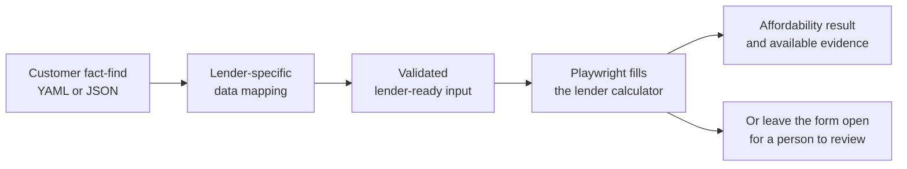
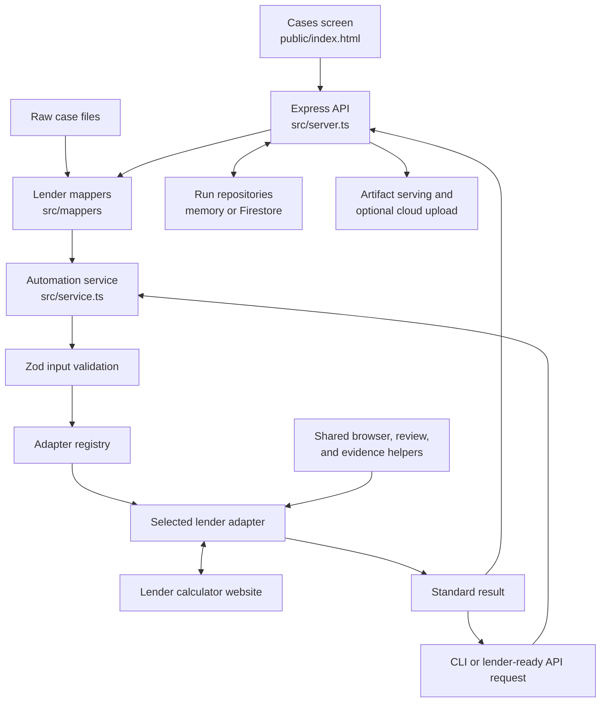
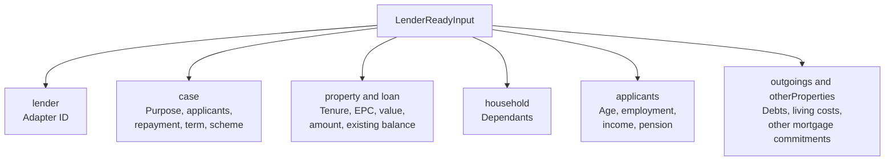
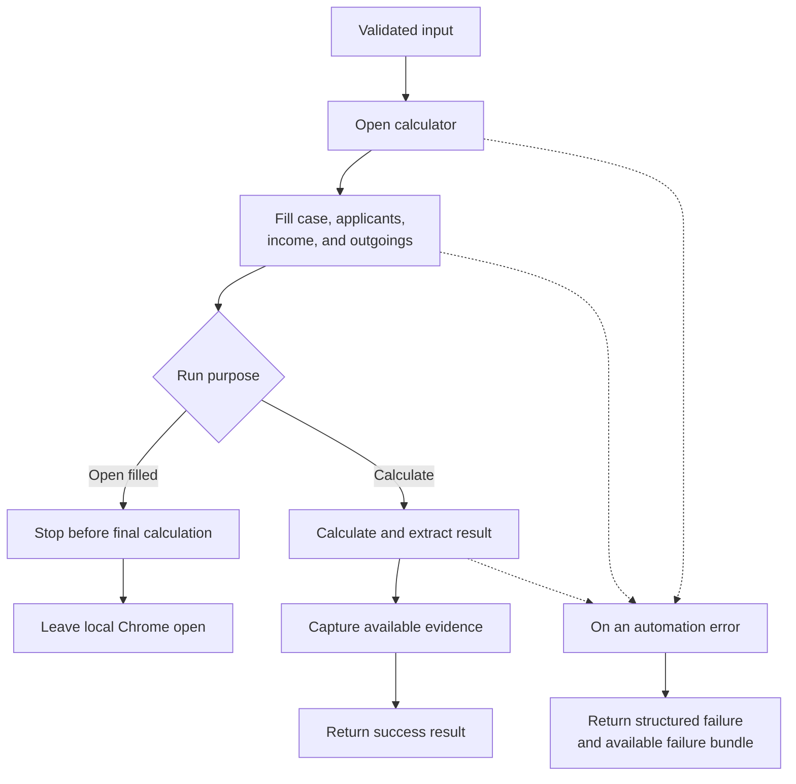
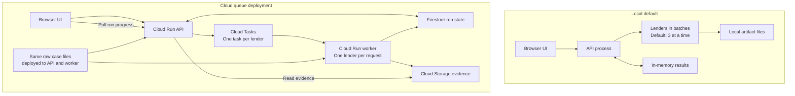
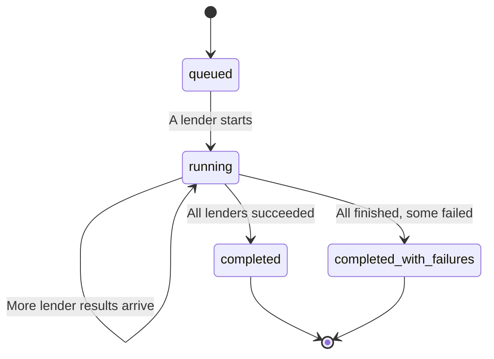
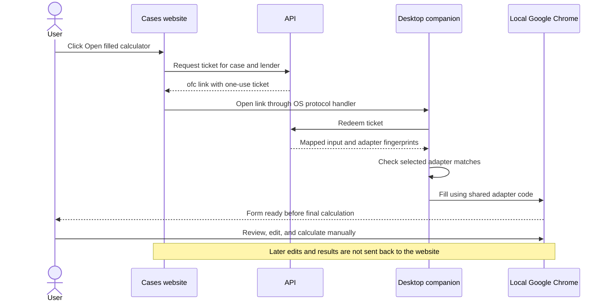
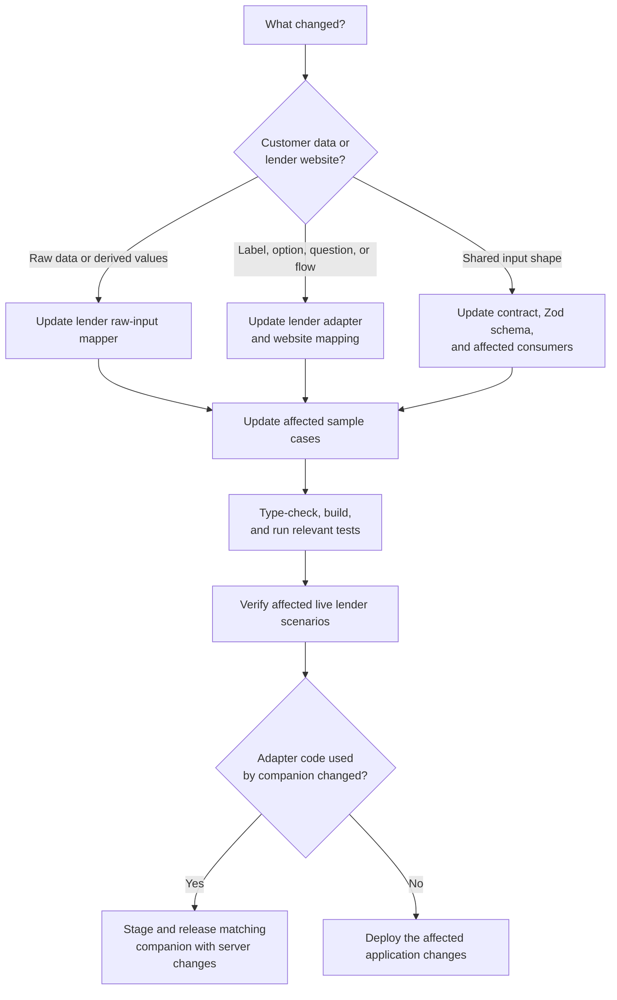

# Mortgage Affordability Automation

**One fact-find. Nine lender calculators. Comparable results, with evidence.**

Built for MortgageKart, this project turns mortgage case data into completed UK lender affordability calculators. It can calculate and return results automatically, or open a pre-filled calculator in the user's own Chrome for review and editing.

The lender's website performs the affordability calculation. This project handles data preparation, browser interaction, result extraction, and evidence capture.



## Start Here

| Your goal | Start with |
| --- | --- |
| Understand the project | [Why it exists](#why-it-exists) and [How the pieces fit](#how-the-pieces-fit) |
| Try it on your computer | [Quick Start](#quick-start) |
| Connect another application | [API Reference](#api-reference) |
| Understand the data | [From Fact-Find to Lender Input](#from-fact-find-to-lender-input) |
| Open an editable lender form | [Open Filled Calculator](#open-filled-calculator) |
| Fix a field or add a question | [Making Changes](#making-changes) |
| Run it in the cloud | [Local and Cloud Execution](#local-and-cloud-execution) |
| Diagnose a failed run | [Troubleshooting](#troubleshooting) |

## Why It Exists

A small change on a lender website can require changes to data mapping, form fields, conditional questions, or result extraction. This project gives each responsibility a clear home.

| Recurring work | How the project helps |
| --- | --- |
| Entering the same case into several calculators | Reuses one raw fact-find and maps it for each lender |
| Updating a lender's questions or selections | Keeps that lender's browser flow and field options in its own adapter folder |
| Finding incorrect or missing input | Validates a shared input contract before running the adapter |
| Comparing differently formatted lender results | Returns the same result structure across lenders |
| Investigating a failed browser run | Captures available screenshots, page content, input, and error details |
| Keeping server and desktop automation aligned | Packages shared adapter code and checks its version before local filling |
| Handling more cases | Supports local batches and a cloud queue with one task per lender |

The expected savings come from less repeated data entry, more targeted code changes, and quicker diagnosis. Actual running costs depend on browser execution time, cloud resources, and evidence storage. Time and cost savings have not been benchmarked.

## Two Ways to Use It

| | Run Affordability | Open Filled Calculator |
| --- | --- | --- |
| Goal | Get a result automatically | Review or change a pre-filled lender form |
| Where the browser runs | On the machine running the API/CLI, or a cloud worker | On the user's computer |
| Final calculate action | Performed by the adapter | Left for the user |
| What comes back | Structured result and available evidence | A local Chrome window ready for editing |
| Extra installation | Playwright Chromium on the execution machine | Google Chrome and the desktop companion |
| Later manual edits sent to the website | Not applicable | No |

**Browser modes are a separate choice.** `managed` starts an automation-owned browser; `attached` connects to a developer-started browser session. Attached mode is useful for debugging and differs from the desktop companion workflow.

## Supported Lenders

All nine lenders have a registered adapter and a raw-input mapper.

| Lender | Input/API ID | Adapter and mapper folder | Mapper command |
| --- | --- | --- | --- |
| Barclays | `barclays` | `barclays` | `npm run map:barclays` |
| Halifax | `halifax` | `halifax` | `npm run map:halifax` |
| HSBC | `hsbc` | `hsbc` | `npm run map:hsbc` |
| Kensington | `kensington` | `kensington` | `npm run map:kensington` |
| Nationwide | `nationwide` | `nationwide` | `npm run map:nationwide` |
| NatWest | `natwest` | `natwest` | `npm run map:natwest` |
| Santander | `santander` | `santander` | `npm run map:santander` |
| Skipton | `skipton` | `skipton` | `npm run map:skipton` |
| Virgin Money | `virgin_money` | `virgin-money` | `npm run map:virgin-money` |

Registration means the implementation exists. Individual scenarios still need live verification because lender websites, validation rules, and availability can change.

## Quick Start

### 1. Install and Build

Run these commands from the repository root. Node.js 22 is recommended, matching the companion release workflow. You also need npm.

```powershell
npm ci
npx playwright install chromium
npm run build
```

On Linux, install browser system dependencies with `npx playwright install --with-deps chromium` if needed.

The examples use PowerShell. On Windows, use `npm.cmd` and `npx.cmd` if PowerShell blocks the corresponding script shims.

### 2. Open the Cases Screen

```powershell
npm run api
```

Open [http://localhost:3000](http://localhost:3000). A successful [health check](http://localhost:3000/health) returns `{"status":"ok"}`.

1. Open a case to inspect its summary and lender rows.
2. Select **Run affordability** from the case list to run all nine lenders.
3. Review the results, expanded error messages, and evidence links where available.
4. Use **Open filled calculator** on a lender row when you need an editable form. This requires the [companion](#open-filled-calculator).

The Cases screen reads YAML/JSON from [samples/test-cases](samples/test-cases), with 49 raw cases currently in the folder. It maps them in memory when needed. Case IDs come from filenames; pre-generated lender JSON files are not the data source for this screen.

Local runs use batches of three lenders by default. Without cloud configuration, no Google Cloud account is required.

### 3. Try One Lender from the CLI

In another terminal, run a supplied lender-ready sample:

```powershell
npx tsx src/cli.ts samples/santander/01-purchase-employed-standard.json
```

Or use the compiled version:

```powershell
node dist/cli.js samples/santander/01-purchase-employed-standard.json
```

Both commands interact with the live lender site and print a JSON result. They do not require the API server. The shortcut `npm run dev` runs the default Halifax sample; it does not start the website.

To watch browser automation, set the environment variable in the same terminal before starting the command:

```powershell
$env:HEADLESS = "false"
npx tsx src/cli.ts samples/santander/01-purchase-employed-standard.json
```

## How the Pieces Fit

A **mapper** translates case data. An **adapter** operates a lender website. A **repository** stores run state. Keeping these roles separate makes it easier to locate a change.



| Technology | Responsibility |
| --- | --- |
| TypeScript and Node.js | Application logic, contracts, CLI, and server |
| Express | JSON API and static web interface |
| Playwright | Lender browser automation and evidence capture |
| Zod | Runtime validation of lender-ready input |
| YAML parser | Reading raw fact-find case files |
| Electron | Optional installed desktop companion |
| Google Cloud Tasks, Firestore, and Storage | Optional queued execution, durable run state, and evidence |

The calculator runtime does not require an OpenAI API key or an LLM. Failure bundles include a repair prompt that a developer can use during investigation; repairs are not applied automatically.

### Repository Map

```text
src/
  server.ts                 Web/API routes and case orchestration
  cli.ts                    Run one lender-ready JSON file
  service.ts                Validate input, select adapter, execute
  config.ts                 Browser settings and artifact paths
  domain/                   Input/output contracts and Zod schema
  mappers/<lender>/          Raw fact-find -> lender-ready input
  map-<lender>.ts            Single-file mapper CLI entry points
  adapters/
    registry.ts             Lender ID -> adapter
    types.ts                Shared adapter interface and run context
    <lender>/adapter.ts     Browser flow and result extraction
    <lender>/mapping.ts     Lender URLs, labels, and option values
    shared/                 Browser, evidence, and review helpers
  repositories/             In-memory and Firestore run state
  infrastructure/           Cloud Tasks dispatch and Storage helpers
  ofc/                      Companion tickets and adapter fingerprints
  companion.ts              Open and fill local Chrome
public/                     Cases interface and companion setup page
companion/                  Electron app, updater, and packaging
samples/                    Raw cases and lender-ready examples
Mapping_xlxs/               Lender mapping reference workbooks
scripts/                    Mapping, sample, debugging, and release tools
docs/                       Detailed guides and lender notes
dist/                       Generated JavaScript; recreated by build
```

Edit `src/` for TypeScript changes. `npm run build` regenerates `dist/`; `npm run companion:stage` also copies the compiled companion code into `companion/dist/`. Both output folders are generated.

## From Fact-Find to Lender Input

There are two entry points into the automation:

- **Raw YAML/JSON:** map it for the selected lender, then validate it.
- **Lender-ready JSON:** send it directly to the CLI or `POST /runs`; the service validates it before execution.

The shared [LenderReadyInput contract](src/domain/contracts.ts) groups the data as follows:



The structure is shared, but the mapped values can differ by lender. For example, income annualisation, outgoing buckets, and accepted options belong in the relevant lender's mapper. Schema validation confirms the expected shape and constraints; it does not guarantee that a lender accepts a scenario.

**Two different kinds of mapping:** `src/mappers/<lender>/raw-to-lender-ready.ts` converts customer data, while `src/adapters/<lender>/mapping.ts` describes website labels, options, and constants.

### Map a Case Yourself

The lender mapper commands in the table above read [input.yaml](input.yaml) and write `samples/<lender>-mapped-from-input.json`.

For a custom file and output location:

```powershell
New-Item -ItemType Directory -Force tmp | Out-Null
npx tsx src/map-halifax.ts input.yaml tmp/halifax-ready.json
npx tsx src/cli.ts tmp/halifax-ready.json
```

Omit the output filename to inspect mapped JSON and mapping issues without writing a file:

```powershell
npx tsx src/map-halifax.ts input.yaml
```

Review any reported mapping issues: they can identify defaults or ambiguous source values.

For batches, each lender has a `map:<lender>:cases` command, for example `npm run map:halifax:cases`. The default scripts read the base raw-case folder. To choose folders explicitly:

```powershell
npm run build
node scripts/map-halifax-raw-cases.mjs samples/raw-additional-cases tmp/halifax-mapped-cases
```

See [Raw Mapping](docs/RAW_MAPPING.md) for the full workflow.

## What Happens During a Lender Run

The exact page order varies by lender, but the adapter lifecycle follows this pattern:



In the companion workflow, a fill failure is shown locally and Chrome can remain open for inspection. Automatic runs capture failure artifacts where possible.

### Reading a Result

This is an illustrative automatic-run result. Evidence fields are optional and vary by lender and execution path.

```json
{
  "lender": "santander",
  "status": "success",
  "maximumBorrowing": 250000,
  "monthlyPayment": null,
  "messages": [],
  "evidence": {
    "screenshotPath": "artifacts/screenshots/example.png",
    "timestamp": "2026-10-19T10:00:00.000Z"
  }
}
```

| Field | Meaning |
| --- | --- |
| `status` | `success` or `failed` for this lender automation |
| `maximumBorrowing` | Extracted borrowing amount; `null` when unavailable |
| `monthlyPayment` | Extracted payment, if the lender supplies it |
| `messages` | Lender messages or workflow information |
| `evidence` | Timestamp and available local paths or Cloud Storage URIs |
| `error` | Failure category and message, present on failed results |

A returned zero borrowing amount differs from a missing result. Read the lender messages alongside the amount. A successful form fill in companion mode also has no extracted borrowing amount.

Failures use categories such as `validation`, `navigation`, `field_fill`, `calculate`, `result_extraction`, and `lender_unavailable`.

## Local and Cloud Execution

Start locally for development. Use the queued cloud path when lender work needs to run independently of the original web request.



| Concern | Local default | Cloud queue deployment |
| --- | --- | --- |
| Case execution | API waits for batches to finish | API returns `202` with a `runId` after dispatch |
| Progress | Results after inline completion | UI polls `GET /api/runs/:runId` |
| State | Process memory; lost on restart | Firestore when configured |
| Evidence | Files on the execution machine | Worker uploads when `EVIDENCE_BUCKET` is configured |
| Data source | Raw case files | Raw case files deployed with each service |

Cloud Tasks sends `runId`, `caseId`, and `lender`; the worker loads and maps the case itself. Keep the API and worker case files in sync.

A complete Cloud Tasks configuration enables queued execution automatically. Setting only `LENDER_WORKER_FANOUT=true` uses the in-process asynchronous dispatcher when Cloud Tasks is absent. That dispatcher is not a durable queue.

### Following an Asynchronous Run

Each lender task has its own result. The aggregate case run completes when all lender tasks finish.



These are the usual aggregate transitions. The contracts also declare failure and timeout states; `AUTOMATION_TIMEOUT_MS` itself is a browser action/navigation timeout, not a total run deadline.

Run records carry 24-hour expiry timestamps. Configure Firestore retention/TTL separately when automatic deletion is required.

Deployment details: [Cloud Run demo](docs/CLOUD_RUN_DEMO_DEPLOY.md), [production deployment](docs/GOOGLE_CLOUD_RUN_PRODUCTION_DEPLOYMENT.md), and [worker/evidence runbook](docs/WORKER_FANOUT_CLOUD_STORAGE_RUNBOOK.md).

## Open Filled Calculator

The optional desktop companion connects a case on the website to an editable lender form on the user's computer.



The ticket expires after two minutes and can be redeemed once. The link contains the ticket and server origin; the mapped case data is fetched during redemption. On first use, the companion asks the user to approve the website origin.

Chrome uses a separate temporary profile, which is removed when the session closes. The companion checks the selected lender's adapter fingerprint against the server. A mismatch stops filling until matching code is installed. With a configured signed update feed, the companion can download updates and install them after open Chrome sessions finish.

### Build the Companion

For Windows packaging:

```powershell
npm ci
npm run companion:stage
npm --prefix companion ci
npm --prefix companion run pack:win
```

Installers are generated in `companion/release/`. Build macOS packages with `pack:mac` and Linux packages with `pack:linux` on their respective operating systems. End users need Chrome and the installer; they do not need Node.js or npm.

For local development after staging and installing companion dependencies:

```powershell
npm --prefix companion start
```

The release workflow is manual and requires signing and publishing configuration. A code push alone does not publish a companion update. See [the companion guide](docs/OFC_COMPANION.md) for setup, release order, compatibility, and platform verification.

## API Reference

Start the server with `npm run api` during development, or `npm run build` followed by `npm start` for compiled execution.

| Method | Route | Purpose |
| --- | --- | --- |
| GET | `/` | Cases interface |
| GET | `/health` | Process health |
| GET | `/api/cases` | List raw cases |
| GET | `/api/cases/:caseId` | Case summary and lender results |
| GET | `/api/cases/:caseId/input` | Raw YAML/JSON source |
| POST | `/api/cases/:caseId/run-affordability` | Run all nine lenders; inline or asynchronous |
| GET | `/api/runs/:runId` | Poll an asynchronous case run |
| POST | `/runs` | Run one lender-ready JSON payload synchronously |
| GET | `/api/artifact?path=...` | Read an allowed local artifact |
| GET | `/api/artifact?uri=gs://...` | Read evidence from the configured bucket |
| POST | `/api/cases/:caseId/ofc/:lender` | Issue an Open Filled Calculator ticket |
| POST | `/api/ofc/redeem` | Redeem the companion ticket |
| GET | `/api/ofc/config` | Companion update/download configuration |
| POST | `/worker/lender-task` | Execute one dispatched lender task |

Example: run one lender through the API with a complete sample payload.

```powershell
$payload = Get-Content -Raw samples/santander/01-purchase-employed-standard.json
Invoke-RestMethod -Method Post -Uri http://localhost:3000/runs -ContentType "application/json" -Body $payload
```

`POST /runs` returns `{ runId, result }` in the response. Its ID is not a pollable asynchronous case-run record.

To start a case run without hard-coding a filename-derived case ID:

```powershell
$cases = Invoke-RestMethod http://localhost:3000/api/cases
$caseId = $cases.cases[0].id
$run = Invoke-RestMethod -Method Post "http://localhost:3000/api/cases/$caseId/run-affordability"
$run
```

If the response has a `runId`, poll it with `Invoke-RestMethod "http://localhost:3000/api/runs/$($run.runId)"`.

See [Web Interface](docs/WEB_INTERFACE.md) for more case/run response details.

## Configuration

The application reads process environment variables. **It does not automatically load a `.env` file.** Set variables in your terminal or deployment environment; [.env.example](.env.example) is a reference.

### Local Automation

| Variable | Default | Purpose |
| --- | --- | --- |
| `PORT` | `3000` | API and website port |
| `HEADLESS` | `true` | Set to `false` to show managed browser windows |
| `BROWSER_EXECUTION_MODE` | `managed` | `managed` or `attached` |
| `BROWSER_WS_ENDPOINT` | Unset | Chrome DevTools WebSocket endpoint for attached mode |
| `AUTOMATION_TIMEOUT_MS` | `30000` | Default browser action/navigation timeout |
| `SCREENSHOT_DIR` | `./artifacts/screenshots` | Screenshot location |
| `FAILURE_ARTIFACT_DIR` | `./artifacts/failures` | Failure bundle location |
| `LENDER_RUN_BATCH_SIZE` | `3` | Number of lenders per local inline batch |

The code default timeout is 30 seconds. `.env.example` and the Docker image specify 60 seconds; the companion also uses 60 seconds. These are not total run-duration limits.

### Cloud and Companion Settings

| Variable | Purpose |
| --- | --- |
| `LENDER_WORKER_FANOUT` | `true` enables asynchronous case dispatch |
| `RUN_STATE_BACKEND` | `firestore` selects durable run and ticket repositories; complete Cloud Tasks configuration also selects them |
| `EVIDENCE_BUCKET` | Bucket for worker evidence uploads and artifact reads |
| `GOOGLE_CLOUD_PROJECT` | Project ID; `GCP_PROJECT` or `PROJECT_ID` are also accepted by task dispatch |
| `CLOUD_TASKS_LOCATION` | Queue region; `CLOUD_TASKS_REGION` is an alias |
| `CLOUD_TASKS_QUEUE` | Queue name |
| `WORKER_URL` | Full worker task endpoint URL |
| `WORKER_INVOKER_SERVICE_ACCOUNT` | Service account used for Cloud Tasks OIDC authentication |
| `WORKER_SHARED_SECRET` | Optional `X-Worker-Secret` validation |
| `OFC_PUBLIC_URL` | Exact public HTTPS website origin; localhost development works without it |
| `OFC_UPDATE_FEED_URL` | HTTPS companion update feed, enabled after signed releases are published |
| `OFC_DOWNLOAD_URL_WINDOWS`, `OFC_DOWNLOAD_URL_MACOS`, `OFC_DOWNLOAD_URL_LINUX` | Optional installer link overrides |

### Attach to a Browser for Debugging

On Windows, start the supplied Chrome/Edge debugging helper:

```powershell
npm run attached:browser
```

Read `webSocketDebuggerUrl` from [http://127.0.0.1:9222/json/version](http://127.0.0.1:9222/json/version), then run:

```powershell
$env:BROWSER_EXECUTION_MODE = "attached"
$env:BROWSER_WS_ENDPOINT = "ws://127.0.0.1:9222/devtools/browser/..."
$env:HEADLESS = "false"
node dist/cli.js samples/halifax/test-case-1.json
```

Use a dedicated debugging profile and keep portal credentials outside the repository.

## Making Changes

Start with the kind of change, then follow it to the owning code.



### Find the Right File

| Change | Start here |
| --- | --- |
| Raw field, income conversion, or outgoing allocation | `src/mappers/<lender>/raw-to-lender-ready.ts` |
| Lender label, option value, or URL | `src/adapters/<lender>/mapping.ts` |
| Conditional question, page flow, or result extraction | `src/adapters/<lender>/adapter.ts` |
| Shared input/output shape | [contracts.ts](src/domain/contracts.ts) and [validation.ts](src/domain/validation.ts) |
| Browser/evidence behavior used by several lenders | `src/adapters/shared/` |
| Case UI or API behavior | [public/index.html](public/index.html) and [server.ts](src/server.ts) |
| Queue dispatch or evidence storage | `src/infrastructure/` |
| Desktop links, installation, or updates | `companion/`, `src/ofc/`, and [companion.ts](src/companion.ts) |

For example, if a lender adds a new question, decide how the answer is derived, update that lender's mapper if needed, add the form interaction, and extend the schema only if the shared model needs a new field. Keep a sample covering the new branch.

Lender-specific changes usually stay in that lender's files. Shared helper/schema changes require wider checks and can change every lender's companion fingerprint.

### Add a Lender

1. Add its ID to the contract and validation schema.
2. Implement its adapter and website mapping, then register it in `src/adapters/registry.ts`.
3. Implement a raw mapper and mapper CLI/script where needed.
4. Wire it into the server's lender lists, mapping dispatch, and ID checks.
5. Update companion lender validation and packaging as needed.
6. Add representative samples, focused tests, and lender documentation; verify both calculation and open-filled behavior.

### Development Commands

| Command | What it does |
| --- | --- |
| `npm run check` | Type-check without generating output |
| `npm run build` | Compile TypeScript into `dist/` |
| `npm test` | Run compiled TypeScript tests; build first |
| `npm --prefix companion test` | Run companion link and updater tests |
| `npm run api` | Start the development web/API server |
| `npm start` | Start the compiled web/API server |
| `npm run dev` / `npm run start:cli` | Run the default Halifax sample from source / compiled output |
| `npm run samples` | Build and run top-level `samples/*.json` against live sites |
| `npm run failures:list` | List recent local failure bundles |
| `npm run companion:stage` | Build and stage shared code for desktop packaging |

A useful verification sequence is:

```powershell
npm run check
npm run build
npm test
npm --prefix companion test
```

Current automated tests cover mapping regressions for case 49, OFC ticket behavior, adapter fingerprints, and companion links/updating. They do not prove every live lender journey works. The sample runner scans only the top-level JSON files, so use the CLI directly for samples in lender subfolders.

## Troubleshooting

| Symptom | First check |
| --- | --- |
| PowerShell blocks npm/npx | Use `npm.cmd` / `npx.cmd` |
| Browser executable is missing | Run `npx playwright install chromium` |
| `npm start` cannot find server output | Run `npm run build` from the repository root |
| Port 3000 is already in use | Set `$env:PORT = "3001"` before starting the API |
| A case does not appear | Check raw YAML/JSON under `samples/test-cases`, parseability, and its derived filename ID |
| Values on a form are wrong | Inspect the mapped input and the lender's raw mapper |
| A field cannot be filled | Check conditional questions, current labels/options, and the lender adapter |
| A timeout occurs | Inspect the page and failure details before adjusting the per-action timeout |
| Results disappear after restart | Local repositories are in memory; configure Firestore for queued durable runs |
| OFC opens no application | Install the companion and Chrome; allow the external-app prompt |
| OFC link has expired or was used | Click the website button again to issue a new ticket |
| OFC reports an adapter mismatch | Install a matching companion release; rebuild/stage after local adapter edits |

Automatic-run failure bundles, when captured, contain:

```text
artifacts/failures/<lender>/<run-folder>/
  failure.json         Error category, message, URL, and artifact references
  input.json           Exact lender-ready input
  page.html            Captured calculator HTML
  visible-text.txt     Text visible on the page
  screenshot.png       Screenshot when available
  repair-prompt.md     Investigation brief for a developer or coding assistant
```

Run `npm run failures:list` to locate recent bundles. First distinguish an automation defect from lender policy validation, invalid case data, or site downtime, then change the relevant code.

## Operational Boundaries

- The current application has no built-in account authentication or per-case permissions. Deployment access controls are needed before exposing real client cases.
- Raw inputs and evidence can contain client information. Keep them and browser profiles out of public repositories and public update buckets.
- Worker protection comes from deployment IAM/OIDC and, optionally, the configured shared-secret header.
- Local evidence disappears if its execution environment is discarded. Worker uploads to Cloud Storage provide durable evidence when configured.
- Lender calculators remain external dependencies. New questions, policy changes, blocking, and downtime can require adapter maintenance.
- The desktop companion leaves manual work in local Chrome; later edits, results, and screenshots are not synced back.

## Further Reading

| Guide | Use it for |
| --- | --- |
| [Project handoff](docs/PROJECT_HANDOFF.md) | Engineering context and historical verification notes |
| [Web interface](docs/WEB_INTERFACE.md) | Cases, run APIs, and response details |
| [Raw mapping](docs/RAW_MAPPING.md) | Mapper commands and generated sample folders |
| [Open Filled Calculator](docs/OFC_COMPANION.md) | Desktop setup, compatibility, signing, and releases |
| [Cloud Run demo](docs/CLOUD_RUN_DEMO_DEPLOY.md) | Initial container deployment |
| [Production deployment](docs/GOOGLE_CLOUD_RUN_PRODUCTION_DEPLOYMENT.md) | Cloud deployment configuration |
| [Worker and evidence runbook](docs/WORKER_FANOUT_CLOUD_STORAGE_RUNBOOK.md) | Queue, worker, state, and storage operations |
| [Project plan](docs/PLAN.md) | Design and implementation background |
| [Raw web/API cases](samples/test-cases/README.md) | Case file conventions and scenario background |
| [Additional raw cases](samples/raw-additional-cases/README.md) | Supplemental input scenarios |

Lender-specific references: [Barclays fields](docs/BARCLAYS_FIELD_MAP.md), [Barclays raw mapping](docs/BARCLAYS_RAW_MAPPING.md), [Halifax fields](docs/HALIFAX_FIELD_MAP.md), [Halifax raw mapping](docs/HALIFAX_RAW_MAPPING.md), [Kensington](docs/KENSINGTON_FIELD_MAP.md), [Skipton](docs/SKIPTON_FIELD_MAP.md), [Virgin Money](docs/VIRGIN_MONEY_FIELD_MAP.md), and [Santander analysis](docs/SANTANDER_COMPLETION_ANALYSIS.md).

The source code defines current behavior. Older guides can contain historical sample counts and verification results; use the current files and focused checks when planning a change.
