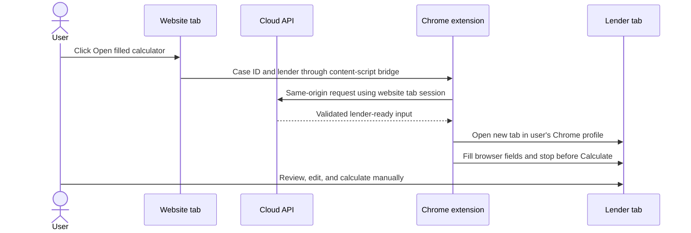

# Chrome extension: open filled lender calculators

This feature opens the real lender calculator in a new tab of the user's existing Chrome profile. The extension fills case fields in that tab and stops before Calculate or Results. The user can edit the lender form and finish it manually. No local Node.js, Playwright, Windows URL handler, or desktop runner is installed.

## Install for development

1. Pull or download this repository on the user's PC. Only the `extension` directory is needed on that PC.
2. Open `chrome://extensions`, enable **Developer mode**, and select **Load unpacked**.
3. Choose the `extension` directory. Keep it on the PC while the extension is installed.
4. Open the website in Chrome and refresh it. Select a case and click **Open filled calculator** in a lender row.
5. The lender tab opens in the same Chrome profile. Review the extension status on that tab, correct any fields it could not find, then continue on the lender site.

For managed distribution, publish the extension through the Chrome Web Store or an organisation's Chrome extension policy. An unpacked extension does not update automatically; reload it after changing its files.

## How the handoff works

The website content script requests `/api/extension-input` using the website tab's session, so a future website login can be used without copying cookies into the extension. The background worker checks the website origin and stores input only in `chrome.storage.session` while the lender tab is being filled. It removes the input when filling finishes or the tab closes. No financial details go into the lender URL, browser history, or custom protocol link. The extension sends no affordability amount or screenshot to the website.

The browser fill plans live in `extension/fill-plan.js`; the DOM filling engine is `extension/lender.js`. These are browser code, separate from the existing Playwright adapters used for server-side affordability runs. Lender site changes can require updating the fill plan. The extension reports required fields it could not find in a status panel on the lender tab and leaves the calculator available for manual correction.

## Website origins

The extension currently accepts the configured Cloud Run demo origin and local development at `localhost`/`127.0.0.1` ports 3000 and 3110. If the production website uses a custom domain, add its HTTPS origin in `extension/website.js` and `extension/background.js`, and add its match pattern in `extension/manifest.json`. Reload or republish the extension. The website and API must be deployed together; an old server without `/api/extension-input` shows a clear error.

The existing project does not yet authenticate users or authorise access to individual cases. Its current case input API is publicly reachable. Add website authentication and per-case access control before using private client data in production. The extension's origin checks are a browser handoff control, not user authentication.

## Verification

Run `npm run test:extension`. It builds the API, checks the same-origin input endpoint, and uses a browser fixture to verify that the extension fills a form without clicking Calculate. Live lender sites require manual verification because their pages and controls change independently of this repository.
