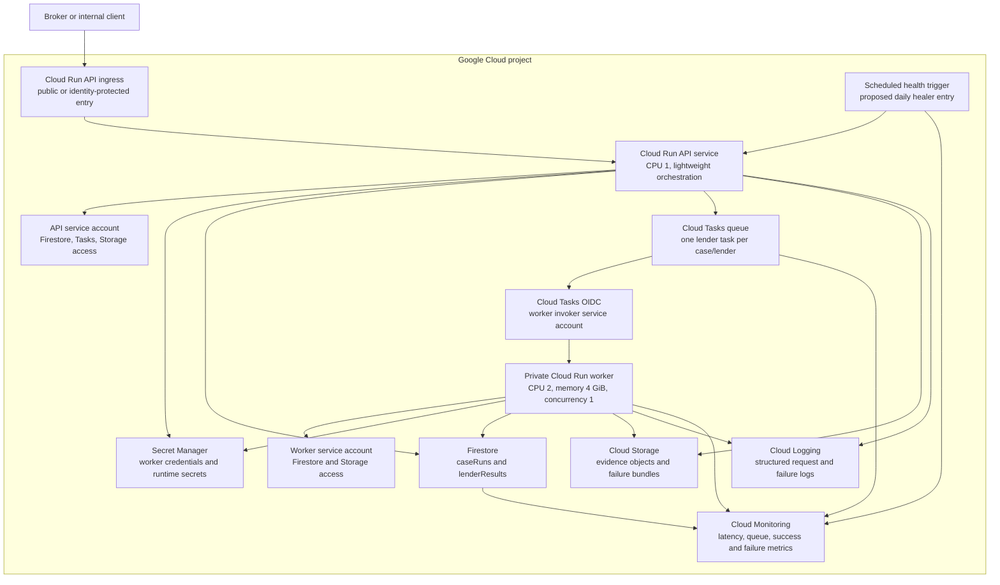
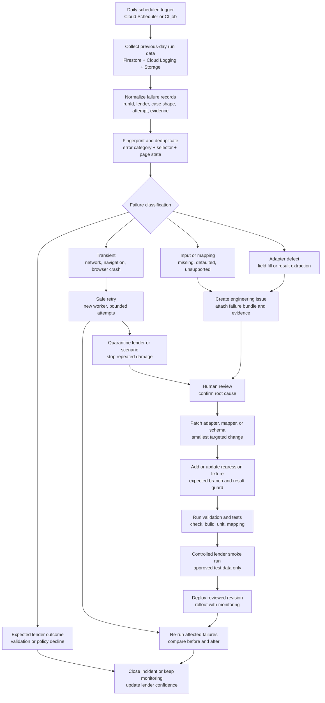

# Mortgage Affordability Automation: Complete Project Summary

## Executive summary

Mortgage Affordability Automation is a TypeScript and Playwright platform for running UK mortgage-intermediary affordability calculations across multiple lender calculators.

The platform accepts either lender-ready JSON or raw fact-find-style YAML/JSON. It maps raw data into a common contract, validates the contract, selects a lender adapter, drives the lender calculator, extracts the result, and returns structured affordability output with evidence.

The project is best described as a **lender affordability execution layer**. It does not replace lender underwriting engines, calculate lending policy itself, or approve mortgage applications. The external lender calculator remains the source of truth for the affordability result.

The repository currently contains:

- 9 registered lender adapters.
- 9 raw-to-lender-ready mappers.
- 49 raw production case files.
- 364 JSON fixtures that validate against the lender-ready schema.
- Playwright browser execution in managed and attached-browser modes.
- Local inline execution and Cloud Tasks fan-out execution.
- In-memory and Firestore-backed run-state repositories.
- Local and Cloud Storage evidence handling.
- A browser UI and REST API.

The architecture is suitable for a production hardening phase. It should not yet be presented as a fully production-secured broker system because authentication, audit controls, full regression execution, distributed idempotency, and operational monitoring still need to be completed.

## Project purpose

Mortgage intermediaries must repeatedly enter the same client information into different lender affordability calculators. Each lender has different:

- Field names and identifiers.
- Conditional questions.
- Income rules.
- Employment categories.
- Property and mortgage structures.
- Validation rules.
- Result-page formats.

This project creates a repeatable execution layer around those differences. The user supplies one case, and the platform can map and run it against the registered lenders without re-entering the case manually for every calculator.

## Product boundary

### The project owns

- Case input normalization.
- Lender-specific mapping.
- Input validation.
- Lender adapter selection.
- Browser automation.
- Result extraction.
- Evidence capture.
- Failure classification.
- Run orchestration.
- Progress tracking.
- Artifact storage.

### The project does not own

- Lender underwriting policy.
- The lender's affordability formula.
- Final mortgage approval.
- Authentication to lender systems.
- CAPTCHA bypass.
- Anti-bot or access-control bypass.
- The broker's source-of-truth CRM or fact-find system.

The project follows the intended rule that it must not bypass CAPTCHA, authentication challenges, or lender security controls.

## Complete production flow

The following diagram describes the full production journey from case submission through lender execution, evidence storage, and result retrieval. The API/orchestrator creates one logical run. Each lender then executes independently so one failure does not block the rest of the case.

```mermaid
flowchart LR
    Client["Broker system or internal client"]
    API["Cloud Run API service<br/>Express + REST + web UI"]
    Raw["Raw case input<br/>Fact-find YAML or JSON"]
    Direct["Direct lender-ready input<br/>POST /runs or CLI"]
    Map["Lender-specific mapping<br/>9 raw-to-ready mappers"]
    Validate["Zod validation<br/>LenderReadyInput"]
    Run["Create case run<br/>runId + lender records"]
    Queue["Cloud Tasks<br/>one task per lender"]
    Worker["Cloud Run lender worker<br/>one browser run per request"]
    Registry["Adapter registry<br/>getAdapter(lender)"]
    Adapter["Selected lender adapter<br/>branch logic + selectors"]
    Browser["Playwright browser<br/>managed or attached mode"]
    Lender["External lender calculator<br/>source of affordability result"]
    Extract["Result extraction<br/>amount + payment + messages"]
    Evidence["Evidence capture<br/>screenshots, PDF, failure bundle"]
    State["Firestore run state<br/>case + lender results"]
    Bucket["Cloud Storage<br/>durable evidence objects"]
    Poll["GET /api/runs/:runId<br/>progress and final results"]
    Output["Normalized AffordabilityResult<br/>success, failure, evidence links"]

    Client --> API
    Raw --> API
    Direct --> API
    API --> Map
    Map --> Validate
    Direct --> Validate
    Validate --> Run
    Run --> State
    Run --> Queue
    Queue --> Worker
    Worker --> Registry
    Registry --> Adapter
    Adapter --> Browser
    Browser --> Lender
    Lender --> Browser
    Browser --> Adapter
    Adapter --> Extract
    Adapter --> Evidence
    Extract --> Output
    Evidence --> Bucket
    Output --> State
    State --> Poll
    Bucket --> Poll
    Poll --> API
    API --> Client
```



### Production flow explained

1. A broker-facing system or internal client starts a case run.
2. The API receives either a raw case or a lender-ready payload.
3. Raw data is mapped separately for each lender.
4. The mapped data is validated against the shared `LenderReadyInput` contract.
5. The API creates a case run and lender-level run records.
6. Cloud Tasks queues one lender task for each registered lender.
7. A worker receives one lender task and opens a browser.
8. The adapter fills the lender calculator using lender-specific selectors and branch logic.
9. The result is accepted only after the adapter confirms the appropriate result state or result page.
10. Evidence is captured for successful and failed runs.
11. The lender result and evidence metadata are saved.
12. The client polls the run and receives partial or complete results.

## Complete Google Cloud handling flow

The production deployment uses Google Cloud to separate API coordination, browser execution, state, and evidence. The API remains lightweight. Browser-heavy work happens in isolated workers with low concurrency.



### Google Cloud responsibilities

#### Cloud Run API service

The API service is responsible for:

- Serving the web UI.
- Receiving case-run requests.
- Loading or accepting case input.
- Applying mappers.
- Validating input.
- Creating run state.
- Enqueuing lender tasks.
- Returning progress and result views.
- Proxying evidence artifacts.

It should not hold browser sessions for the full multi-lender run in production.

#### Cloud Tasks

Cloud Tasks provides the fan-out boundary. A case run creates one task per lender.

Each task contains:

```json
{
  "runId": "case-run-id",
  "caseId": "case-id",
  "lender": "halifax"
}
```

The current dispatcher can attach an OIDC token and an optional shared-secret header. Production should enforce identity-based invocation rather than relying on an optional shared secret alone.

#### Private Cloud Run worker

The worker runs exactly one lender task per request. This isolates browser memory and failure behavior.

Recommended operating characteristics:

- Concurrency: 1 initially.
- CPU: 2 vCPU.
- Memory: approximately 4 GiB.
- Request timeout: bounded per lender.
- Maximum instances controlled by expected lender volume.
- Private ingress or IAM-protected invocation.

#### Firestore

Firestore stores:

- Case-run status.
- Total lender count.
- Completed, successful, and failed counts.
- Per-lender status.
- Result payload.
- Error message.
- Runtime duration.
- Expiry metadata.

The current implementation has both an in-memory repository and a Firestore repository. Local mode uses memory. Production fan-out uses Firestore when configured.

#### Cloud Storage

Cloud Storage stores:

- Screenshots.
- Multi-step success evidence.
- Evidence PDFs.
- Failure bundle files.

Objects are organized below a run/lender-specific prefix. The API only accepts objects from the configured evidence bucket.

#### Logging and monitoring

The production design should record, by lender and run:

- Run ID.
- Case ID or redacted case reference.
- Lender.
- Attempt number.
- Start and end time.
- Duration.
- Result status.
- Error category.
- Browser crash or navigation timeout.
- Evidence capture status.

Sensitive borrower values should not appear in normal logs.

## Daily production failure healer flow

The project already produces failure bundles and includes a local failure-listing script. A complete daily failure-healing loop is a proposed operational layer around those capabilities. It is not yet fully implemented as a scheduled production service.

The purpose of the healer is to separate transient failures from data, mapping, selector, and lender-policy failures, then drive safe recovery without silently changing affordability outcomes.



### Failure-healing rules

#### Retry automatically

Only retry failures likely to be transient:

- Navigation timeout.
- Temporary lender 5xx response.
- Browser crash.
- Temporary service unavailability.

Retries must be bounded and idempotent.

#### Do not blindly retry

Do not automatically retry:

- Missing required data.
- Mapping warnings that affect meaning.
- Selector failures.
- Result extraction failures.
- Unsupported lender branches.
- Expected lender policy declines.

Those cases should produce an actionable issue with the failure bundle attached.

#### Quarantine repeated failures

If one lender repeatedly fails across unrelated cases, the system should mark that lender as degraded, reduce dispatch pressure, and alert engineering rather than generating a large number of identical failures.

#### Repair loop

The repair loop should always include:

1. Visible page evidence.
2. Current URL or calculator section.
3. Input summary.
4. Exact error category.
5. A regression fixture for the repaired path.
6. A controlled re-run before deployment.

This prevents a selector patch from fixing one case while silently breaking another branch.

## Core components

### CLI

Entry point:

```text
src/cli.ts
```

The CLI accepts a lender-ready JSON file and prints an `AffordabilityResult`.

Example:

```powershell
npm.cmd run build
node dist\cli.js .\samples\halifax\test-case-1.json
```

### Automation service

Entry point:

```text
src/service.ts
```

The service performs the common execution sequence:

1. Parse and validate input.
2. Resolve the lender adapter.
3. Execute the adapter.
4. Return the normalized result.

### Browser session layer

File:

```text
src/adapters/shared/browser.ts
```

Execution modes:

- `managed`: launches a Playwright browser owned by the process.
- `attached`: connects over Chrome DevTools Protocol to an existing browser session.

Attached mode exists because some lender sites may reject a fresh automated browser context while allowing an established broker session.

### Adapter layer

Files:

```text
src/adapters/<lender>/adapter.ts
src/adapters/<lender>/mapping.ts
```

Each adapter contains lender-specific:

- Calculator URL.
- Page flow.
- Selectors.
- Conditional branches.
- Income mapping.
- Outgoings mapping.
- Existing-property mapping.
- Result extraction.
- Failure detection.

### Mapper layer

Files:

```text
src/mappers/<lender>/raw-to-lender-ready.ts
src/map-<lender>.ts
```

Mappers translate the raw fact-find representation into the common contract. The workbook references are stored in:

```text
Mapping_xlxs/
```

Mapper output may contain warnings when a lender workbook field cannot be represented exactly in the shared contract.

### Evidence layer

Evidence is described by `AutomationEvidence` in `src/domain/contracts.ts`.

Possible evidence includes:

- One or more screenshots.
- A PDF compiled from screenshots.
- A failure bundle directory.
- Local paths.
- Cloud Storage URIs.
- Capture timestamp.

### Run-state layer

Files:

```text
src/repositories/run-state.ts
src/repositories/run-repository.ts
src/repositories/firestore-run-state-repository.ts
```

The repository abstraction allows local development without Google Cloud while preserving a path to durable production state.

## Data contracts

### `LenderReadyInput`

The shared input contract includes:

- `lender`.
- Mortgage purpose.
- Application type and applicant count.
- Repayment type and term.
- Shared ownership or equity information.
- Property value, tenure, EPC, and Scotland flag.
- Loan amount and current balance.
- Dependants.
- Applicant age, employment, income, pension, and other income.
- Monthly commitments and outgoings.
- Other properties.
- Other mortgage commitments.

The current validation rules enforce numeric ranges, allowed enum values, applicant count consistency, and a required business type for self-employed applicants.

Branch-specific validation is not yet complete for every lender path. For example, interest-only, remortgage, existing-property, and lender-specific income requirements need stronger semantic validation.

### `AffordabilityResult`

The output contract contains:

```text
lender
status
maximumBorrowing
monthlyPayment
messages
evidence
error.category
error.message
```

Error categories are:

- `validation`.
- `navigation`.
- `field_fill`.
- `calculate`.
- `result_extraction`.
- `lender_unavailable`.

## API reference

| Endpoint | Purpose |
|---|---|
| `GET /health` | Basic health response. |
| `GET /` | Serves the browser UI. |
| `GET /api/cases` | Lists available raw cases. |
| `GET /api/cases/:caseId` | Returns case details and lender results. |
| `GET /api/cases/:caseId/input` | Returns the raw case file. |
| `POST /api/cases/:caseId/run-affordability` | Starts a multi-lender run. |
| `GET /api/runs/:runId` | Returns asynchronous run progress and results. |
| `POST /runs` | Runs a direct lender-ready payload. |
| `POST /worker/lender-task` | Runs one queued lender task. |
| `GET /api/artifact?path=...` | Reads an allowed local artifact. |
| `GET /api/artifact?uri=gs://...` | Streams an artifact from the configured bucket. |

## Configuration reference

### Browser and local runtime

| Variable | Meaning |
|---|---|
| `BROWSER_EXECUTION_MODE` | `managed` or `attached`. |
| `BROWSER_WS_ENDPOINT` | CDP endpoint required for attached mode. |
| `HEADLESS` | Set to `false` to show the browser. |
| `AUTOMATION_TIMEOUT_MS` | Default Playwright timeout. |
| `SCREENSHOT_DIR` | Local screenshot directory. |
| `FAILURE_ARTIFACT_DIR` | Local failure-bundle directory. |
| `PORT` | API port, default `3000`. |
| `LENDER_RUN_BATCH_SIZE` | Local inline concurrency, default `3`. |

### Production runtime

| Variable | Meaning |
|---|---|
| `LENDER_WORKER_FANOUT` | Enables asynchronous fan-out when `true`. |
| `RUN_STATE_BACKEND` | Uses Firestore when set to `firestore`. |
| `EVIDENCE_BUCKET` | Cloud Storage bucket for evidence. |
| `GOOGLE_CLOUD_PROJECT` | Google Cloud project identifier. |
| `CLOUD_TASKS_LOCATION` | Cloud Tasks queue region. |
| `CLOUD_TASKS_QUEUE` | Cloud Tasks queue name. |
| `WORKER_URL` | Worker endpoint used by Cloud Tasks. |
| `WORKER_SHARED_SECRET` | Optional worker header secret. |
| `WORKER_INVOKER_SERVICE_ACCOUNT` | Optional OIDC service account for Cloud Tasks. |

## Supported lender coverage

The current registered lenders are:

```text
Barclays
Halifax
HSBC
Kensington
Nationwide
NatWest
Santander
Skipton
Virgin Money
```

The scenario corpus covers combinations such as:

- Single and joint applicants.
- Purchase, remortgage, capital raising, and further advance.
- Employed, self-employed, contractor, pension, and other income.
- Sole trader, limited company, partnership, and LLP paths.
- Dependants.
- Other properties and mortgage commitments.
- Shared ownership and shared equity.
- Interest-only and part-and-part repayment types.
- Scotland and leasehold cases.
- High outgoings and complex income.

Coverage breadth is a strong project asset. It is not the same as live regression confidence. The nested sample folders still need a recursive execution runner and controlled live smoke coverage.

## Evidence and failure handling

Successful runs can return:

- Maximum borrowing.
- Monthly payment when available.
- Calculator messages.
- Screenshots.
- PDF evidence.
- Timestamp.

Failed runs can return:

- Error category.
- Human-readable message.
- Failure screenshot.
- Failure bundle.
- Input summary.
- HTML and visible page text.

The failure bundle is designed to support a repeatable debugging loop:

1. Inspect the visible calculator state.
2. Identify the failed branch or validation message.
3. Compare the state with the lender field map.
4. Patch the smallest relevant selector or mapping rule.
5. Re-run the exact case.
6. Add or update regression coverage.

## Security and compliance position

The current project should be treated as a controlled demo or internal prototype until the following controls are implemented:

- Application authentication.
- Authorization by user, role, and case ownership.
- Private worker invocation.
- Secret Manager for runtime secrets.
- Redacted structured logging.
- Audit trails for case access and execution.
- Explicit evidence retention and deletion.
- Signed or authenticated evidence access.
- Encryption and access review for Firestore and Cloud Storage.
- Protection against unbounded case execution and abuse.

The current API exposes raw case input through an endpoint and does not provide application-level authentication. Cloud Run IAM can protect an entire service, but it does not by itself provide user-level application authorization.

## Operational maturity

### Implemented foundations

- TypeScript strict compilation.
- Shared input and output contracts.
- Lender adapter registry.
- Managed and attached browser execution.
- Structured failure categories.
- Evidence capture.
- Cloud Tasks dispatcher.
- Firestore run-state repository.
- Cloud Storage artifact upload.
- Local web interface.
- Seven passing automated tests in the current build.

### Current limitations

- The default sample runner scans only top-level JSON files.
- Full live lender regression is not automatically executed.
- Lender confidence is not represented as a formal runtime metric.
- Mapper warnings are not consistently surfaced through the web flow.
- Firestore aggregate updates need transactional and idempotent hardening.
- Retry, dead-letter, circuit-breaker, and per-lender rate-limit behavior need production implementation and verification.
- The `/health` endpoint is a basic process-health response, not a full dependency health check.
- Local state is lost when the process restarts.
- The current UI/API has no application authentication.

## Main technical risks

### Lender UI drift

External calculator structure can change without notice. Exact field maps, smoke tests, failure fingerprints, and per-lender monitoring are required.

### False result extraction

An arbitrary currency value on a page is not necessarily the affordability result. Result extraction must require the correct result page or explicit result state.

### Semantic mapping loss

Different lenders ask for different income and property details. A structurally valid normalized payload can still lose meaning when a lender-specific field has no direct representation.

### Distributed state races

Multiple workers may update the same case aggregate concurrently. Firestore writes should use transactions, atomic counters, or a result-derived aggregate model.

### Duplicate task delivery

Cloud Tasks can deliver tasks more than once. The worker must be idempotent for the combination of `runId`, `caseId`, and lender.

### Sensitive evidence exposure

Screenshots, HTML, visible page text, and failure bundles can contain sensitive financial information. Storage, access, logging, and retention need explicit policy.

## Recommended production hardening roadmap

### Phase 1: Verification spine

- Make the sample runner recursive.
- Add lender filters.
- Add validation-only tests for all fixture folders.
- Add shared result-extraction tests.
- Add mapper-warning assertions.
- Add CI gates for check, build, and test.

### Phase 2: Correctness and reliability

- Assign confidence levels to each adapter.
- Add branch-specific domain validation.
- Complete Santander exact field mapping.
- Verify Nationwide property and ownership branches.
- Add explicit result-page guards.
- Add test cases for invalid and lender-declined scenarios.

### Phase 3: Production controls

- Add authentication and authorization.
- Enforce private worker IAM/OIDC.
- Add request IDs and structured logs.
- Add metrics by lender and error category.
- Add retry and dead-letter policies.
- Add idempotency keys.
- Make run aggregation transactional.
- Configure Firestore TTL and Cloud Storage lifecycle rules.

### Phase 4: Daily operations

- Implement the daily failure healer workflow.
- Fingerprint repeated failures.
- Automatically retry safe transient failures.
- Quarantine degraded lenders.
- Create issues with evidence bundles.
- Require regression fixtures for adapter repairs.
- Re-run affected cases after deployment.

### Phase 5: Scale

- Add lenders one adapter at a time.
- Measure p50 and p95 duration per lender.
- Benchmark worker memory and concurrency.
- Tune Cloud Run maximum instances.
- Introduce lender-specific queues if rate limits require them.
- Validate the target case volume with realistic load tests.

## CTO presentation position

The strongest presentation position is:

> The difficult part of this product is not launching browsers. It is creating a controlled, repeatable, evidence-producing abstraction over fragmented lender calculators. That abstraction now exists. The next stage is to convert broad functional coverage into measured production reliability and secure operations.

The project should be presented as:

- A working platform foundation.
- A reusable adapter architecture.
- A multi-lender mapping system.
- An auditable execution and evidence model.
- A Cloud Run scaling shape.
- A clearly bounded hardening program.

It should not be presented as:

- A replacement for lender underwriting.
- A guaranteed affordability decision engine.
- A fully secure external customer platform.
- A finished 50-lender production service.

## Repository guide

| Area | Location |
|---|---|
| Project overview | `README.md` |
| TypeScript source | `src/` |
| Domain contracts | `src/domain/contracts.ts` |
| Validation | `src/domain/validation.ts` |
| API and orchestration | `src/server.ts`, `src/service.ts` |
| Lender adapters | `src/adapters/` |
| Raw mappers | `src/mappers/` |
| Cloud Tasks | `src/infrastructure/cloud-tasks-dispatcher.ts` |
| Cloud Storage | `src/infrastructure/cloud-storage-artifacts.ts` |
| Run state | `src/repositories/` |
| Browser UI | `public/index.html` |
| Field maps | `docs/*_FIELD_MAP.md` |
| Deployment plan | `docs/GOOGLE_CLOUD_RUN_PRODUCTION_DEPLOYMENT.md` |
| Fan-out runbook | `docs/WORKER_FANOUT_CLOUD_STORAGE_RUNBOOK.md` |
| Web interface | `docs/WEB_INTERFACE.md` |
| Project handoff | `docs/PROJECT_HANDOFF.md` |
| Santander risk analysis | `docs/SANTANDER_COMPLETION_ANALYSIS.md` |

## Verification snapshot

The repository was inspected and validated during preparation of this summary.

```text
npm.cmd run check   passes
npm.cmd run build   passes
npm.cmd test        7 tests passed
JSON fixtures       364 validated
Raw production cases 49
Registered lenders  9
Registered mappers  9
```

Live lender calculator execution was not included in this verification pass because it would submit sample financial cases to external lender systems. Live success-rate claims should therefore be supported by controlled smoke-test results before being used as production evidence.

## Related documentation

- [README](../README.md)
- [Detailed project plan](PLAN.md)
- [Project handoff](PROJECT_HANDOFF.md)
- [Raw mapping guide](RAW_MAPPING.md)
- [Web interface](WEB_INTERFACE.md)
- [Google Cloud Run production plan](GOOGLE_CLOUD_RUN_PRODUCTION_DEPLOYMENT.md)
- [Worker fan-out runbook](WORKER_FANOUT_CLOUD_STORAGE_RUNBOOK.md)
- [Santander completion analysis](SANTANDER_COMPLETION_ANALYSIS.md)
